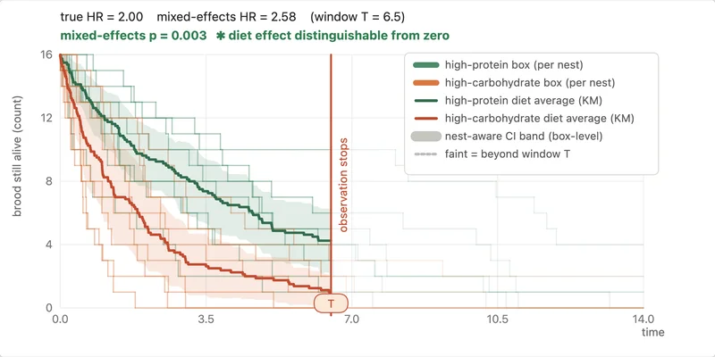
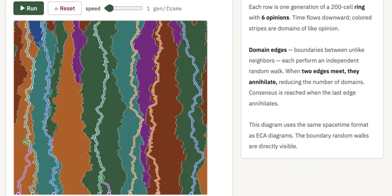
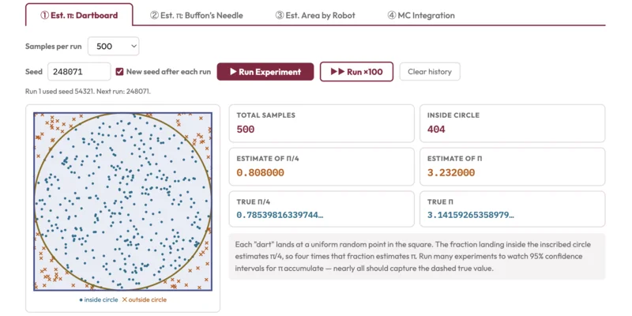
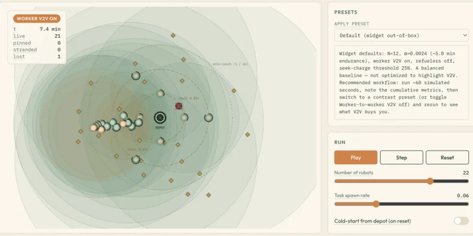

# Ted Pavlic

Associate Professor at Arizona State University in the [School of Computing and
Augmented Intelligence](https://scai.engineering.asu.edu/) and the [School of
Life Sciences](https://sols.asu.edu/), where I lead the
[BEET Lab](https://pavliclab.org/) (Bringing Ecology and Engineering Together).
Most of what's here is teaching material; lab research code lives in
[PavlicLab](https://github.com/PavlicLab).

  
  
  
  

## What's here

- [Topic Visualizers](https://tpavlic.github.io/topic_visualizers/):
  interactive explainers across science, math, statistics, and engineering
- [Research Sandbox](https://tpavlic.github.io/research_sandbox/):
  work-in-progress explorations from ongoing research
- Course visualizations for
  [Simulating Stochastic Systems](https://tpavlic.github.io/asu-simulating-stochastic-systems/)
  and
  [Bio-Inspired AI & Optimization](https://tpavlic.github.io/asu-bioinspired-ai-and-optimization/)
- [Notes, Documents, and Guides](https://github.com/tpavlic/docs-and-guides):
  Markdown guides for students and colleagues
- [md2qti](https://github.com/tpavlic/md2qti): Markdown quizzes to Canvas QTI
- LaTeX tools: [splncs04nat](https://github.com/tpavlic/splncs04nat),
  [latex_cv_template](https://github.com/tpavlic/latex_cv_template), and
  [scholarly-review-template](https://github.com/tpavlic/scholarly-review-template)

## Elsewhere

[Personal website](https://tedpavlic.com/) ·
[ASU profile](https://search.asu.edu/profile/1995237) ·
[Google Scholar](https://scholar.google.com/citations?user=UAmGg-cAAAAJ) ·
[YouTube](https://www.youtube.com/@TedPavlic) ·
[LinkedIn](https://www.linkedin.com/in/tedpavlic/) ·
[Bluesky](https://bsky.app/profile/tedpavlic.bsky.social)
